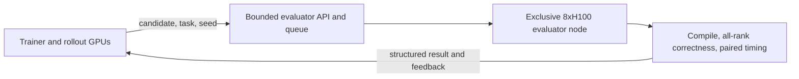

# RL Subteam Technical Deliverable

## Multi-turn execution RL for transferable multi-GPU kernel optimization

**Prepared for:** Purdue VIP Pre-trained Models, RL subteam
**Prepared by:** Andre
**Date:** September 28, 2026
**Status:** Research and feasibility recommendation; proposed thresholds must be agreed on before the pilot

## Executive recommendation

I recommend that we run the proposed one-week feasibility pilot, with one important scope change: the pilot should establish a trustworthy evaluator, usable multi-turn trajectories, and a measured compute budget. It should not attempt a meaningful RL training run.

The direction has a credible research gap. ParallelKernelBench (PKB) exposes 87 multi-GPU workloads and reports that even strong models often fail on rank coordination and tensor partitioning. Its public harness already supports PyTorch/NCCL references, CUDA/Triton/ParallelKittens candidates, per-rank correctness checks, performance measurement, and a configurable agent path demonstrated with a three-step limit. That makes it a strong evaluation starting point. It is not, by itself, a training corpus or a production RL environment. The project’s hardest scientific problem is therefore not writing a GRPO loop. It is constructing non-leaking training tasks and a stable, high-throughput execution service whose timing signal remains trustworthy over a long run. [PKB repository](https://github.com/togethercomputer/ParallelKernelBench) · [PKB problem dataset](https://huggingface.co/datasets/togethercomputer/ParallelKernelBench_Problems)

The published PKB results leave room for a new method: GPT-5.5 produced 28/87 correct and 22/87 correct-and-faster kernels zero-shot; best-of-three sampling reached 36 correct and 27 faster. Gemini 3 Pro moved from 24 correct/12 faster zero-shot to 35 correct/26 faster with iterative execution feedback, then plateaued around 20 refinement steps. Those results motivate learning from interaction, but they do not show that weight updates transfer coordination strategies to unseen patterns. [Official PKB results](https://www.together.ai/blog/parallelkernelbench) · [PKB paper](https://openreview.net/pdf/b1f965d99dc4c0341f70248f27b0e3dc29ce4f51.pdf)

My strongest technical objection is resource coupling. A PKB episode can occupy all eight GPUs of an 8×H100 node, while 14B policy inference and training also need GPU capacity. One 8-GPU node cannot concurrently serve as the trainer and as a full 8-rank evaluator at useful throughput. The pilot can time-multiplex those roles or generate each round in batches, but a full online-RL experiment will probably need separate policy/training and evaluator resources. We should measure this rather than assume that the proposed 48–72 node-hours covers training.

For the learning stack, I recommend **verl plus the public KernelGYM/Dr.Kernel implementation**. We should implement ordinary GRPO as the required baseline, but use Dr.Kernel’s turn-level leave-one-out method (TRLOO) as the stronger multi-turn method. Dr.Kernel identifies a self-inclusion bias in naive multi-turn GRPO and releases an environment, training code, datasets, checkpoints, and multi-turn recipes. Reusing that work keeps our contribution focused on multi-GPU coordination and transfer. [Dr.Kernel paper](https://arxiv.org/abs/2602.05885) · [KernelGYM repository](https://github.com/hkust-nlp/KernelGYM)

The pilot is a **go** only if it passes explicit gates for cleanup, timing stability, trajectory diversity, data availability, and projected cost. Until then, model size should remain a parameter rather than a commitment.

## The research question I would take forward

> Starting from the same prepared open-weight checkpoint, does multi-turn execution-based RL improve correct-and-fast performance on held-out multi-GPU workloads and held-out coordination patterns more than verified imitation training and equal-compute test-time refinement without weight updates?

This wording makes four requirements explicit:

1. **Same starting checkpoint.** The causal comparison cannot mix different initial models or different cold-start data.
2. **Equal execution budget.** RL and test-time refinement must receive the same number of candidate executions, turns, generated tokens, and approximately the same evaluator GPU-seconds.
3. **Transfer is structural.** A random split of shapes from the same task template does not establish reusable coordination. At least one confirmatory split must hold out a communication or parallelism family, with separate held-out shapes and world sizes.
4. **Correct-and-fast is the outcome.** Speed among already-correct survivors can hide a loss of correctness. The primary metric should score both together.

The reusable communication representation can be a mechanism or an ablation, but it should not be the central novelty claim. ParallelKittens already organizes multi-GPU kernels around a small set of reusable communication and overlap primitives. A defensible contribution is evidence about whether execution RL learns coordination strategies that transfer, under controlled budgets and non-leaking splits. [ParallelKittens paper](https://arxiv.org/abs/2511.13940)

## What we have now

### Local SysLLMatic repository

The current repository is useful historical infrastructure for iterative optimization, profiling, and evaluation over HumanEval C++, SciMark Java, and DaCapo Java. It is not a runnable multi-GPU RL stack. The initial audit found no GRPO/DPO trainer, CUDA/NCCL task environment, current policy checkpoint, or multi-GPU rollout traces. The Fall 2026 continuation now includes a minimal, reproducible TRL CPU smoke test under `experiments/grpo_smoke`; this validates local GRPO plumbing but does not supply the missing CUDA/NCCL evaluator or training corpus. The LLM agent code is also oriented around the earlier generator/evaluator/advisor workflow. We should preserve it as project history and reuse its experimental discipline, but adapting it into a distributed kernel trainer would cost more than starting from current public kernel-RL infrastructure.

This also changes one assumption in `Migration.md`: timing consistency within a batch is not sufficient. *Reinforcement Learning for Code Optimization* reports that uncalibrated local timing shifted an unchanged solution’s mean percentile rank by 41.2 points, while a calibrated execution service improved stored-versus-fresh Spearman correlation from 0.54 to 0.96. The paper’s strongest results required changes to the test distribution, sandbox calibration, reward, group sampling, batching, advantage normalization, and rollout staleness. [Reinforcement Learning for Code Optimization](https://arxiv.org/abs/2607.25970)

### ParallelKernelBench

PKB supplies most of the evaluator’s basic semantics:

- 87 PyTorch + NCCL reference workloads spanning several parallelism patterns;
- per-rank outputs and tolerance-based correctness comparison over five random trials by default;
- reference-versus-candidate timing with 500 warmups and 100 timed iterations;
- CUDA, Triton, and ParallelKittens backends;
- `torchrun`/NCCL execution on Linux with hardware profiles including `h100_8`;
- an agent-generation entry point with configurable step and timeout limits;
- local, Together-container, and Modal execution paths.

The current benchmark is an **intra-node** benchmark over NVLink-connected devices. A successful study should describe its scope as intra-node multi-GPU coordination and should not claim transfer to multi-node networking unless we add and validate a separate inter-node suite.

The public dataset contains the reference programs and task metadata. It should be treated as evaluation data. If we use 10–15 PKB tasks while developing the pilot, those task IDs become a development set and must be excluded from the untouched confirmatory result. [PKB README](https://github.com/togethercomputer/ParallelKernelBench/blob/main/README.md) · [PKB dataset](https://huggingface.co/datasets/togethercomputer/ParallelKernelBench_Problems)

What PKB does not yet give us is equally important: a separate training distribution, a proven long-running online-RL service, or an anti-leakage split. There is also a concrete recovery gap in the current local runner: it creates a new process group, but its ordinary `proc.communicate()` call has no timeout; whole-group termination is implemented for a user interrupt, not for an automatically detected deadlock. A hung collective can therefore block indefinitely. The Modal wrapper has a platform timeout, but that does not prove the local node is clean and reusable. Closing and testing this gap is the first pilot task. [PKB local runner](https://raw.githubusercontent.com/togethercomputer/ParallelKernelBench/main/run_local.py) · [PKB worker](https://raw.githubusercontent.com/togethercomputer/ParallelKernelBench/main/scripts/worker.py)

### Public training assets worth reusing

| Asset | What it contributes | How I would use it |
|---|---|---|
| [KernelGYM / Dr.Kernel](https://github.com/hkust-nlp/KernelGYM) | Distributed GPU evaluator, multi-turn training code, failure recovery, reward-hacking checks, public SFT/RL data and 8B/14B models | Primary implementation base; plain GRPO baseline and TRLOO main method |
| [verl](https://github.com/volcengine/verl) | Distributed RL training, asynchronous multi-turn agent loops, FSDP/Megatron support, vLLM/SGLang rollouts, external tools/rewards | Trainer/orchestrator under the adapted environment |
| [Afterburner](https://github.com/Elfsong/Afterburner) | Public iterative code-optimization recipe, execution sandbox, GRPO configuration, and data | Methodology reference and CPU-code sanity check, not a multi-GPU evaluator |
| [daVinci-kernel](https://github.com/GAIR-NLP/daVinci-kernel) | Skill selection, policy, and skill-summary agents with execution-verified skill admission | Transfer/skill-library reference; optional later baseline |
| [SemRep](https://github.com/cirrus-uchicago/SemRep) | Semantic preparation, KernelBench reward service, and a verl GRPO recipe | Preparation baseline if we retain the condition-focused study |

Afterburner’s reported result is useful evidence that iterative execution RL can improve code efficiency: its paper reports pass@1 rising from 47% to 62% and the probability of beating human submissions rising from 31% to 45%. Its published system repeatedly invokes a single-step policy and greedily keeps improvements; it does not train end-to-end credit assignment over a retained interaction history. Its appendix reports that adding history-aware prompts only at inference performed poorly, which supports training with our exact multi-turn feedback schema. It also does not resolve multi-rank correctness or communication. [Afterburner proceedings paper](https://proceedings.neurips.cc/paper_files/paper/2025/file/0d1d415fb1a14ba3bb56b831d1eecbe7-Paper-Conference.pdf)

Dr.Kernel is more directly relevant. It reports that naive multi-turn GRPO has biased advantage estimation when a sampled turn contributes to the group statistic used to score itself. TRLOO removes that self-inclusion. It also adds mismatch correction, profiling-based rewards, and profiling-based rejection sampling to address reward hacking and “lazy” correct-but-unoptimized solutions. The released recipe uses three turns and 16 rollouts per prompt, which is a reasonable starting configuration to measure rather than blindly adopt. [Dr.Kernel paper](https://arxiv.org/abs/2602.05885)

### Trainer choice

| Trainer | Strength for this project | Main limitation | Recommendation |
|---|---|---|---|
| [verl](https://github.com/volcengine/verl) | Custom asynchronous agent/reward loops, exact token/mask handling across turns, Ray plus FSDP/Megatron, vLLM/SGLang rollouts, checkpointing and trajectory tracing; used by Dr.Kernel, Afterburner, SemRep, and daVinci-kernel | More infrastructure work; parts of the agent API are still evolving | Durable implementation and reported experiments |
| [TRL GRPOTrainer](https://huggingface.co/docs/trl/grpo_trainer) | Fastest way to connect a stateful environment or custom rollout/reward to a Hugging Face model | Async GRPO/environment features are newer and it is less aligned with the released kernel-RL patches | Optional one-week demonstration against the same evaluator API |
| [OpenRLHF](https://openrlhf.readthedocs.io/en/latest/agent_training.html) | Multi-turn agent interface, remote reward services, Ray/DeepSpeed/vLLM, multi-node operation | Less direct reuse of Dr.Kernel’s method and trajectory tooling | Fallback if the team already has stronger operational experience with it |

The evaluator API should remain trainer-independent. That lets us prototype with TRL if needed and move to verl without rewriting correctness, timing, or recovery logic.

### Checkpoints

`Qwen/Qwen3-14B-Base` is a defensible controlled starting model: it is an Apache-2.0 base checkpoint with 14.8B parameters and a 32,768-token context. Its BF16 weights alone are about 29.6 GB; training requires substantially more memory for gradients, optimizer states, activations, reference policy, and rollout serving. FSDP/offload across eight 80-GB H100s may make it practical, but fit is not the same as acceptable rollout throughput. [Qwen3-14B-Base model card](https://huggingface.co/Qwen/Qwen3-14B-Base)

A rough full-parameter mixed-precision Adam planning floor is about 16 bytes per parameter, or roughly 237 GB for 14.8B parameters, before activations, rollout KV caches, the reference policy, fragmentation, and evaluator memory. The pilot must measure the actual configuration rather than using weight memory as its feasibility test.

There is a tradeoff between attribution and pilot viability:

- **Scientific starting point:** Qwen3-14B-Base, after the same verified cold-start/SFT preparation for every causal arm.
- **Infrastructure smoke test:** Qwen3-8B-Base or another smaller Qwen base, because failures are cheaper.
- **Frozen-model trajectory pilot:** an instruction/cold-start-capable open checkpoint, or the prepared Qwen checkpoint. A raw base model may produce so few parseable multi-turn candidates that the pilot mostly measures missing instruction preparation.
- **Transfer references:** `hkust-nlp/drkernel-8b`, `hkust-nlp/drkernel-14b`, and a daVinci-kernel checkpoint if available. These should not initialize the main causal comparison because they already encode kernel-RL training.

I would not lock 14B until the pilot records generation latency, evaluator latency, peak memory, and the proportion of trajectories that produce valid source files.

### Purdue hardware

Purdue’s Gautschi AI partition is the closest documented match to the proposed evaluator: its H subcluster has 20 nodes, each with eight NVIDIA H100 80-GB GPUs, 112 CPU cores, about 1 TB of RAM, and 400-Gbps NDR networking. Purdue describes the AI partition as eight-way NVLinked H100 nodes. Access depends on a group’s purchased GPU-hour allocation and jobs are charged per GPU-hour. [Gautschi overview](https://rcac.purdue.edu/index.php/compute/gautschi) · [Gautschi queues](https://docs.rcac.purdue.edu/userguides/gautschi/run_jobs/queues/)

The proposed 48–72 **8-GPU node-hours** equals 384–576 H100 GPU-hours. That is plausible for an evaluator pilot, but it is not a full-training estimate. For scale, *Reinforcement Learning for Code Optimization* reports 10,000 optimizer steps, 16 samples per prompt, and rollouts averaging roughly 10,000 tokens; its Qwen2.5-7B run used eight H100 nodes for about one day, or roughly 192 H100 node-hours before counting separate CPU execution capacity. Its 32B run was much larger. Our evaluator consumes an entire eight-GPU node per concurrent 8-rank episode, so a full run could be more expensive even with fewer policy parameters.

The trainer and evaluator should be separated during measured runs. Sharing GPUs would contaminate latency, compete for memory, and make NCCL failures harder to attribute.

We still need to verify our actual allocation and topology. “Spark nodes” is not specific enough to decide suitability. Before promising any experiment, run `slist` on the Purdue cluster, identify the eligible account and remaining GPU-hour balance, and record `nvidia-smi topo -m`, CUDA, NCCL, driver, container, storage, wall-time, and outbound-network constraints. Gilbreth’s documented nodes generally expose at most four GPUs per node, so it is not an equivalent 8-rank target. [Gilbreth overview](https://www.rcac.purdue.edu/knowledge/gilbreth/overview)

## Proposed episode and evaluator contract

Each episode should have a fixed, machine-readable contract.

**Initial observation**

- PyTorch + NCCL reference implementation;
- declared hardware profile, dtype, shapes, world size, tolerances, and allowed backend;
- candidate API and file constraints;
- a short optimization objective;
- the best independently verified incumbent and the current exploratory candidate, if this is a revision turn;
- no hidden-test implementation or reference timing distribution.

**Action**

- one complete candidate source file;
- optional structured fields describing collective choice, partitioning, and overlap plan;
- no arbitrary shell commands from the model.

**Environment pipeline**

1. Parse and statically validate the candidate.
2. Compile in an isolated workspace with a hard deadline.
3. Launch all ranks in a new process group with unique rendezvous state.
4. Validate every rank over public development inputs.
5. If correct, run independent hidden shapes/seeds and anti-hacking checks.
6. Only after correctness passes, perform synchronized timing and optional profiling.
7. Return typed feedback and either start the next turn or terminate.

**Feedback**

- failure class: format, compile, launch, timeout, rank crash, collective mismatch, numerical mismatch, or performance failure;
- failing rank(s), concise sanitized compiler/runtime output, and output error summary;
- synchronized candidate and reference timing only when correctness passed;
- optional profiler summary with a fixed schema;
- no hidden expected outputs or data that lets the actor reconstruct the hidden test.

**Termination**

- maximum three revision turns for the first pilot;
- early success when the candidate is correct and clears the pre-registered speed threshold;
- immediate termination for forbidden behavior or unrecoverable node failure.

The environment should keep two candidate tracks. The **safe incumbent** changes only after an all-rank-correct, confidence-qualified speed improvement. The **exploratory candidate** may be correct but slower and can still become the input to the next turn. This preserves potentially useful intermediate transformations without allowing a regression to replace the episode’s final answer.

Every evaluation must produce a durable record with task ID and split, model/checkpoint hash, prompt/template hash, generated source hash, turn number, seed, world size, hardware/driver/CUDA/NCCL versions, compile result, per-rank correctness, raw timing samples, profiler summary, failure class, wall time, and evaluator revision.

## Reward and learning-method recommendation

The pilot should log rich outcomes but avoid tuning a complicated scalar reward before timing is calibrated. My proposed plain-GRPO baseline reward is a collapsed gate:

$$
R_{collapsed} =
\begin{cases}
+1, & C \land H \land G \\
-1, & \text{otherwise.}
\end{cases}
$$

where:

- \(C=1\) only if every rank passes every required correctness test;
- \(H=1\) only if anti-hacking and output-integrity checks pass;
- \(G=1\) only if the confidence-adjusted speedup exceeds the pre-registered threshold.

Compilation failures, hangs, incorrect outputs, and correct-but-unverified speedups receive no positive performance credit. Their typed diagnostics remain in the next observation. Because PKB correctness may initially be sparse, we should screen a two-gate alternative as well: `-1` for invalid/incorrect, `0` for correct but not measurably faster, and `+1` for correct and faster. This adds a correctness learning signal while still withholding performance credit from wrong code. A continuous performance reward or Afterburner-style additive reward should be a later ablation screened first with logged trajectories or an offline reward simulator.

The speed gate should be above the measured noise floor. A provisional `1.05×` gate is reasonable, while reporting PKB-style `fast_1` and `fast_1.2` results as secondary metrics. The final training threshold must be chosen from repeated reference/anchor measurements before seeing model-arm results.

Before a costly online run, replay stored verified candidates and sampled timing observations through the exact reward code. Reject reward configurations with excessive zero-advantage groups, poor correlation with stable speed ordering, frequent rerun label flips, or any path that gives speed credit to incorrect code. This offline screen can eliminate degenerate rewards; it cannot substitute for evidence that the policy learns.

For multi-turn learning:

1. Run **plain GRPO with terminal reward** as the requested baseline.
2. Run **TRLOO with the same episodes, reward, and budget** as the stronger method because it removes the reported self-inclusion problem.
3. Keep intermediate outcomes for analysis; add turn-level shaping only as a pre-registered ablation.
4. Center group returns but do not divide by group standard deviation in the robust configuration. The code-optimization paper found standard-deviation normalization problematic with sparse/noisy rewards.
5. Start with no replay buffer and cap policy staleness. The code-optimization study discarded contexts older than 30 optimizer steps; our appropriate limit should follow measured evaluator throughput.
6. Preserve exact model tokens through the multi-turn loop. Re-encoding reconstructed chat history can change tokenization and corrupt the policy-gradient likelihoods; verl’s agent-loop documentation explicitly warns about token-in/token-out handling. [verl multi-turn agent loop](https://verl.readthedocs.io/en/latest/advance/agent_loop.html)
7. Train with the same history and structured-feedback schema used at evaluation. Repeated single-turn calls to a single-turn-trained model do not establish that the policy learned multi-turn use of feedback.
8. Execute siblings from one prompt group close together on the same calibrated service. If an infrastructure fault remains inconclusive after one clean retry, discard the entire sibling group rather than comparing rewards produced under different conditions.

The main reason to use verl/KernelGYM instead of implementing GRPO from scratch is that environment concurrency, policy staleness, token accounting, process isolation, and recovery determine whether the optimization is valid. A short local GRPO implementation would demonstrate an equation, not solve those systems problems.

## One-week feasibility pilot

The pilot should answer five questions:

1. Can every candidate job terminate and leave the node reusable, including deliberate hangs and rank failures?
2. Is the timing signal stable enough to rank candidates across sessions?
3. Does a frozen open model produce enough correct or partially useful trajectories for group-relative learning?
4. What is the measured candidate-evaluation throughput and resulting node-hour estimate?
5. Is there a credible path to a separate, non-leaking training distribution?

### Day 0: freeze scope and inventory

- Reserve 10–15 representative PKB task IDs as a **development-only pilot set**. Stratify across collective/parallelism family and expected failure mode. Record the IDs before running the model.
- Reserve the remaining chosen evaluation subset untouched.
- Record checkpoint, backend, world size, turns, samples, seeds, correctness tolerances, and maximum execution budget.
- Inventory Gautschi/Spark access, allocation, software stack, model artifacts, existing traces, and storage.
- Decide who can restart/quarantine a failed node and how GPU health is checked.

### Days 1–2: harden the evaluator

- Bring up unmodified PKB references on the target node.
- Add a parent watchdog, process-group termination, child/orphan detection, unique rendezvous ports and directories, bounded log capture, and cleanup of temporary artifacts.
- Inject failures: syntax error, compiler timeout, one-rank crash, one-rank infinite loop, collective mismatch/deadlock, OOM, and stale port.
- After each forced failure, run a known-good reference and inspect GPU/process health.
- Save a structured result object even when the job fails.

### Day 3: calibrate correctness and timing

- Run references and any known candidate kernels repeatedly across fresh sessions.
- Use barriers and the slowest-rank/makespan latency for the multi-GPU result.
- Interleave reference and candidate measurements or use stable anchor kernels to detect drift.
- Retain raw samples. Report median, dispersion, and bootstrap confidence intervals rather than only a single speedup.
- Measure the false-ordering rate for candidates whose performance is close.

PKB’s 500 warmups and 100 timed iterations are a defensible starting protocol, but the pilot must confirm that it is stable on our hardware rather than treating those counts as universal.

### Days 4–5: collect frozen-policy trajectories

- Run two or three feedback turns with frozen weights.
- Prefer four or more independent trajectories per task for the pilot; if compute permits, use group sizes closer to the intended training setting.
- Record compile, launch, correctness, speed, and failure-transition rates by turn.
- Count prompt groups with at least two distinct reward levels. GRPO cannot learn from an all-equal group.
- Measure generation time, queue time, compile time, execution time, profiling time, cleanup time, and end-to-end node-hours.
- Project the cost of 1,000, 10,000, and the intended number of optimizer steps using observed values and explicit concurrency assumptions.

### End-of-week decision gates

These are proposed project thresholds, not claims from the cited papers. We should agree on them before the pilot.

| Gate | Proceed if | Stop or redesign if |
|---|---|---|
| Recovery | All of at least 50 injected compile/rank-crash/OOM/deadlock faults terminate within the wall-clock bound, leave no descendants, and are followed by a healthy known-good run; at least 95% are classified correctly as program or infrastructure failures | Orphans, stale NCCL state, unhealthy GPUs, or routine manual resets remain |
| Timing | Known ±5% candidate pairs are ordered correctly at least 95% of the time, speed labels flip on at most 5% of reruns, and the latency-ratio 95% CI half-width is at most 2.5% | Candidate ordering changes materially across sessions or near-threshold noise is uncontrolled |
| Correctness | Every claimed success passes all ranks and independent hidden shapes/seeds | Public-test-only solutions or output shortcuts survive |
| RL signal | With group size 8–16, at least 30% of groups contain more than one reward level; at least 10% of candidates are correct overall or at least half the tasks have one correct candidate; at least three tasks yield a lower-95%-bound speedup above 1.05 | Nearly all groups are uniform failure or uniform trivial success |
| Throughput | The upper-confidence compute projection fits a confirmed allocation with a 2× contingency | The estimate assumes evaluator/trainer overlap that the hardware cannot provide |
| Data | A practical path exists to at least 50 independent workload templates across at least five communication/parallelism families, split by template/family rather than repeated shapes | PKB must be reused as training data or template leakage makes transfer untestable |

A failed gate is still a useful result. It tells us whether to narrow to fewer GPUs, use offline verified trajectories, study test-time refinement, or pivot to evaluator/data construction.

### Current implementation status

On October 4, 2026, I ran a one-step TRL 1.14.1 GRPO preflight on CPU under WSL 2. It generated a four-completion group, exercised separate task and diagnostic rewards, produced nonzero reward variance and gradient norm, changed LoRA parameters, wrote `checkpoint-1`, reloaded it, and generated from the reloaded adapter. The exact script, resolved environment, metrics, samples, parameter hashes, checkpoint manifest, and report are under `experiments/grpo_smoke`. Model weights and optimizer state remain outside Git in the WSL work directory.

This confirms that the local trainer plumbing works. It does not test the project feasibility question. A meaningful kernel pilot still requires Linux CUDA/NCCL hardware, an exclusive multi-GPU allocation, the PKB evaluator, a chosen useful checkpoint, and a non-leaking task corpus. The first useful evaluator task remains the bounded PKB executor and calibration harness on the actual target node. The trainer should be attached only after that environment passes the recovery and timing gates.

## Full experiment after a successful pilot

### Core arms

All arms start from the same base checkpoint and the same verified cold-start preparation.

| Arm | Weight updates | Execution feedback at test time | Purpose |
|---|---:|---:|---|
| Prepared checkpoint | SFT/cold start only | Fixed evaluation budget | Establish pre-RL capability |
| Verified imitation | Yes, on accepted demonstrations | Fixed evaluation budget | Test whether copying verified behavior is sufficient |
| Online execution RL | Yes, from live rollouts | Same budget | Test learned transfer from execution feedback |
| Test-time refinement | No after preparation | Same turns/executions/tokens as RL evaluation | Separate weight learning from search/refinement |

Plain GRPO and TRLOO can be sub-arms of online RL. Dr.Kernel and daVinci-kernel can be reported as external transfer references if licenses, formats, and hardware permit, but they should not replace the controlled arms.

The cleanest analysis is a small factorial design: training in `{none, verified imitation, execution RL}` crossed with inference in `{one-shot, feedback loop}`. Add a no-feedback repeated-sampling control with the same candidate count. This separates learning from extra samples and from access to execution feedback.

### Data and splits

- **Training:** separately generated or curated multi-GPU tasks; no PKB references, solutions, model outputs, hidden evaluator data, or close upstream variants. Deduplicate against PKB with token, AST, repository-origin, and semantic checks where practical.
- **Development:** the pre-registered 10–15 pilot PKB tasks or a separate internal dev suite.
- **Test:** untouched PKB tasks plus hidden perturbations.
- **Shape split:** new dimensions/dtypes within known task families.
- **World-size split:** train and test on different supported rank counts where the reference semantics permit it.
- **Pattern split:** hold out at least one communication/parallelism family. This is the strongest transfer test.

Split at the semantic template/family level before generating parameter variants. Otherwise many correlated variants can make confidence intervals look much tighter than the true generalization evidence.

An older base-checkpoint release date reduces direct exposure to PKB solutions, but it cannot rule out exposure to the public upstream repositories from which benchmark code was drawn. Record the exact model revision and audit every cold-start/SFT dataset; describe this as contamination mitigation, not proof of zero exposure.

### Metrics

**Primary endpoint**

- fraction of held-out tasks whose final incumbent is all-rank correct and whose lower 95% confidence bound on speedup exceeds the pre-registered threshold, under a fixed execution/turn budget. A provisional threshold is `1.05×`, subject to pilot calibration.

**Secondary endpoints**

- all-rank correctness/pass@1 and pass@k;
- PKB-style `fast_1`, `fast_1.05`, and `fast_1.2` rates;
- geometric-mean speedup, reported both conditional on correctness and with failures included in the task-level success rate;
- time/turn to first correct and first correct-and-fast candidate;
- compile, hang, crash, rank-mismatch, and numerical-mismatch rates;
- reward-hacking incidence;
- performance by communication family, shape, and world size;
- generated tokens, candidate executions, evaluator GPU-seconds, trainer GPU-hours, and end-to-end node-hours.

Evaluate the prepared checkpoint and trained checkpoint on the same held-out tasks with paired seeds. Use task-level paired bootstrap confidence intervals for rate and speedup differences. Use a paired binary test such as McNemar’s test for correctness/fast-threshold outcomes. Do not count parameter variants from one template as independent tasks.

Claim that RL is better only if its paired task-level difference versus both verified imitation and frozen-weight refinement has a 95% bootstrap confidence interval above zero and clears a pre-registered practically meaningful margin; five percentage points is a reasonable proposal. Average over at least three training seeds. If the budget cannot support three seeds, describe the result as a pilot rather than firm evidence of RL superiority.

## Relation to the earlier condition-focused idea

The condition-focused proposal remains useful, but it should be an experiment layered onto a working pipeline. Multi-GPU optimization is inherently conditional: a partition or collective can be correct for one world size, divisible shape, memory layout, topology, or synchronization assumption and wrong or slower for another. That maps directly onto the failures PKB highlights.

A later preparation study could compare, before identical RL:

1. ordinary verified optimization demonstrations;
2. condition-focused examples pairing an optimization with applicability and counterexample conditions;
3. a SemRep-style semantic preparation baseline.

The condition-focused examples should test behavior, not only ask for verbal explanations. For example, the same optimization can be executed under stable versus changing state, divisible versus non-divisible partitions, two versus eight ranks, or NVLink-friendly versus communication-bound shapes. The evaluator then measures whether the model applies or declines the transformation appropriately. This would be a meaningful contribution if it improves held-out conditional decisions after the same RL budget. It should not be mixed into the first infrastructure pilot because that would make failures hard to diagnose.

SemRep should be described precisely in this comparison: it separately trains a semantic-representation objective and an instruction-transformation objective, then uses a two-stage evolutionary inference procedure. It is a strong preparation-and-search baseline, not an existing demonstration of long-horizon multi-turn RL credit assignment.

## Recommended division of work

### Andre

- Own the trainer decision and minimal plain-GRPO/TRLOO experiment configuration.
- Specify the episode schema, reward gate, group-variation analysis, policy-staleness logging, and equal-budget comparison.
- Verify the candidate checkpoint and cold-start requirements.
- Obtain the exact Gautschi/Spark account, topology, and allocation information.
- Produce the end-of-pilot compute projection and go/no-go recommendation.

### Manas

- Bring up PKB references and candidates on the target hardware.
- Select the stratified development tasks and document which PKB IDs are burned for development.
- Implement/test timeout, process-tree cleanup, crash recovery, and artifact collection.
- Investigate a separate training-task source or generator.

### Amr

- Define the structured feedback schema and measure whether revisions use the feedback.
- Build failure-transition metrics, such as compile failure → running, wrong output → correct, and correct → faster.
- Help design hidden correctness perturbations and anti-hacking checks.

### Srrey

- Own the final research framing, related-work boundary, and communication with Professor Davis.
- Secure or coordinate GPU access and decide the resource ceiling.
- Pre-register the pilot decisions and keep core baselines on the same checkpoint and budget.

### Shared

- Go to Professor Davis’s office hours with the research question, resource topology, dev/test split, proposed gates, and the one unresolved decision: whether the full study can obtain separate policy/training and eight-GPU evaluator capacity.

## Questions to settle with Professor Davis or RCAC

1. Do we have an eligible Gautschi `ai` account, and how many H100 GPU-hours remain?
2. Can we reserve full eight-GPU nodes, and can two nodes be used concurrently for policy/training and evaluation?
3. Are containers, custom CUDA extensions, long-lived model servers, and internal network services permitted?
4. What are the wall-time, storage, job-array, and preemption limits?
5. What exactly are the “Spark nodes”: GPU model, count, memory, topology, CUDA/NCCL versions, and allocation policy?
6. Do we already possess a prepared checkpoint, training tasks, accepted traces, or an evaluator branch that is not in the current SysLLMatic repository?
7. Is the intended contribution primarily the training algorithm, the training data/split, structured feedback, or evidence of transfer? My recommendation is the last two, using established RL machinery.

## Slack-ready response

> I looked into the GRPO/trainer, checkpoint, evaluator, and GPU questions. My concrete finding is that we should not make naive multi-turn GRPO the main method. Dr.Kernel shows a self-inclusion bias in multi-turn GRPO and releases KernelGYM plus a turn-level leave-one-out method (TRLOO), multi-turn recipes, datasets, and 8B/14B checkpoints. I suggest that we adapt KernelGYM/verl to PKB, keep ordinary GRPO as the required baseline, and compare it with TRLOO under the same reward and execution budget.
>
> PKB gives us a useful evaluator foundation—87 PyTorch/NCCL tasks, per-rank correctness, timing, and a configurable multi-step agent path—but it does not give us a separate RL training corpus or prove long-run hang recovery. I think the one-week pilot should focus on 10–15 development-only tasks, fault-injecting hangs/rank crashes, calibrating timing, collecting two- or three-turn frozen-model trajectories, and measuring how often rollout groups have mixed rewards. We should reserve the rest of PKB as untouched evaluation data.
>
> The largest compute concern is that an 8-rank PKB evaluation can occupy the entire 8×H100 node while a 14B trainer/rollout server also needs GPUs. A single node can support a serial pilot, but full online RL probably needs separate trainer and evaluator capacity. Purdue’s Gautschi AI partition appears to have the right 8×H100 node type, but we still need to verify our account, balance, and topology. The requested 48–72 node-hours equals 384–576 H100 GPU-hours and should be described as evaluator-pilot compute, not the full RL allocation.
>
> I support doing the pilot if we agree on go/no-go gates in advance: reliable process cleanup, stable candidate ranking across sessions, enough non-uniform reward groups for GRPO, a non-leaking training-data plan, and a measured full-run cost. I can own the RL configuration, reward/metrics, checkpoint comparison, and compute projection. I can commit **[insert realistic number] hours next week**.

The bracketed time commitment is the only personal detail that still needs to be filled in before sending.

## Immediate action checklist

- [x] Run and archive a one-step local CPU GRPO plumbing preflight.
- [ ] Insert a realistic weekly time commitment in the Slack response and send it.
- [ ] Ask Srrey/Professor Davis whether the main claim is transfer across communication patterns; use that to define the split before experiments.
- [ ] Run `slist` and record the available Gautschi account, GPU-hour balance, and eligible partitions.
- [ ] Obtain exact Spark-node specifications instead of reasoning from the name.
- [ ] Confirm whether a second GPU node or separate inference resource is possible.
- [ ] Fork/pin exact commits of PKB and KernelGYM after hardware access is confirmed.
- [ ] Write the episode result schema and pre-register pilot task IDs, seeds, thresholds, and stop conditions.
- [ ] Run fault injection and timing calibration before attaching any trainer.
- [ ] Take the measured throughput and full-study estimate to Professor Davis before requesting the full allocation.

## Sources

- [ParallelKernelBench repository and evaluator documentation](https://github.com/togethercomputer/ParallelKernelBench), [paper](https://openreview.net/pdf/b1f965d99dc4c0341f70248f27b0e3dc29ce4f51.pdf), and [official results](https://www.together.ai/blog/parallelkernelbench)
- [ParallelKernelBench problem dataset](https://huggingface.co/datasets/togethercomputer/ParallelKernelBench_Problems)
- [Dr.Kernel paper](https://arxiv.org/abs/2602.05885) and [KernelGYM code](https://github.com/hkust-nlp/KernelGYM)
- [Reinforcement Learning for Code Optimization](https://arxiv.org/abs/2607.25970)
- [Afterburner NeurIPS paper](https://proceedings.neurips.cc/paper_files/paper/2025/file/0d1d415fb1a14ba3bb56b831d1eecbe7-Paper-Conference.pdf) and [code](https://github.com/Elfsong/Afterburner)
- [daVinci-kernel paper](https://arxiv.org/abs/2606.16497) and [code](https://github.com/GAIR-NLP/daVinci-kernel)
- [ParallelKittens paper](https://arxiv.org/abs/2511.13940)
- [SemRep paper](https://arxiv.org/abs/2603.13640) and [code/training recipe](https://github.com/cirrus-uchicago/SemRep)
- [verl multi-turn agent loop](https://verl.readthedocs.io/en/latest/advance/agent_loop.html)
- [Hugging Face TRL GRPOTrainer](https://huggingface.co/docs/trl/grpo_trainer)
- [OpenRLHF agent training](https://openrlhf.readthedocs.io/en/latest/agent_training.html)
- [NVIDIA NeMo RL GRPO](https://docs.nvidia.com/nemo/rl/latest/about/algorithms/grpo.html)
- [Qwen3-14B-Base model card](https://huggingface.co/Qwen/Qwen3-14B-Base)
- [Purdue Gautschi overview](https://rcac.purdue.edu/index.php/compute/gautschi) and [queue documentation](https://docs.rcac.purdue.edu/userguides/gautschi/run_jobs/queues/)
